# 赛博朋克 UI：标题、歌曲列表、结算与游玩 HUD

全部玩家界面已经作为可交互的 Unity UGUI 接入原来的 `GeometryRhythmDemo` 场景，不是图片或视频。2026-09-18 版本采用深色赛博朋克视觉；现有游玩背景、Note 皮肤、四种判定规则、JSON 格式和不限帧设置保留。

## 1. 如何运行

打开 `Assets/RhythmDemo/Scenes/GeometryRhythmDemo.unity`，等待编译后按 Play。默认先显示黑底启动读条，加载完成后进入标题登录页，而不是立即播放歌曲。也可以运行 `Builds/RhythmHacker/RhythmHacker.exe`；分发时携带整个目录。

### 2026-10-01 登录 / MainUI 动效优化

参考用户提供的 [UI 呼吸感视频](https://www.bilibili.com/video/BV15LKH6PETX/) 中已查看的卡片、图表和数据面板片段，保留紫色像素美术与既有操作流程，统一轻位移、分层出现和柔和收尾。

- 登录：品牌文字依次出现，账户卡片轻微上移、缩放并淡入；头像扫描线改为缓慢、首尾透明的循环；输入框聚焦下划线平滑展开；错误反馈为 0.44 秒衰减晃动，提示文字仍保留原来的 1.05 秒。退出时卡片轻微后退，登录过场与音频时间线保持原样。
- 桌面：主窗口与舞台、信息面板、四张状态卡分层出现。Main / Diary / Friends / News / Music 窗口统一整体等比缩放、淡入淡出；最小化以对应任务栏位置为目标。动画不再改变窗口布局尺寸或裁切框，文字与内部内容保持完整，静止后回到精确的原始尺寸。
- 中途恢复从当前显示的位置、缩放和透明度继续，不先跳回动画起点；拖动后的窗口坐标在最小化与恢复后保留。保留原有关闭回调、交互门槛、防连点和剧情事件时机。
- 开始菜单短距离上浮/下沉；背景、说明、返回标题弹窗沿用统一动效；新闻详情轻移淡入，日记内容切换淡入。壁纸使用首尾平滑的交叉淡化，通知出现/消失与通知队列补位更柔和，任务栏颜色、活动标记和移除后的补位平滑变化。
- 按钮仅在悬停、聚焦和按下时提供阻尼缩放及柔和色彩反馈，空闲图标不循环浮动。动效均使用 unscaled time，窗口不在动画中重排子布局。
- 实现：`DesktopMotion.cs`、`RhythmFrontendDesktopMotion.cs` 与原视图的动画调用点。`DesktopMotionCapture.cs` 为按命令行启用的运行验证入口，正常游玩不会运行。
- 验证入口：`-frontendSmoke -desktopDockSmoke -demoCapture <目录>`；连续动效捕获：`-frontendSmoke -desktopMotionCapture <目录>`。后者逐帧检查窗口布局尺寸与等比缩放，并验证密码、各窗口、动画中途反向恢复、真实拖拽处理器及恢复坐标、新闻详情、开始菜单、背景切换和取消返回。
- 最终结果：Unity 构建与 239 项规则检查通过；`GEOMETRY_DESKTOP_DOCK_SMOKE PASS=True`、`DESKTOP_MOTION_CAPTURE_PASS=True`（583 个实际 GPU 渲染帧）。人工检查登录、窗口缩放、新闻详情和弹窗关键帧；未以静态截图代替动态验证。预览 `Screenshots/desktop-motion-preview.mp4` 按捕获时间戳编码，1600×900、29.6 秒、无声，完整解码通过；编码帧率不代表游戏实测性能。

### 2026-10-01 编辑器 CanvasGroup 缺失修复

- 上述 Player 验证未覆盖 Unity Editor 的特殊空对象语义。编辑器中，`GetComponent<CanvasGroup>() ?? AddComponent<CanvasGroup>()` 可能保留一个缺少原生组件的包装对象，导致登录/桌面入场访问 `alpha` 时抛出 `MissingComponentException`，中断界面初始化及登录过场。
- 动效中的五处组件获取统一改用 `DesktopMotion.GetOrAdd<T>`，通过 `TryGetComponent` 判断组件存在性；入场组件声明 `RectTransform` / `CanvasGroup` 依赖。入场动画未初始化时不执行 Update，失效引用也不继续写入，保留现有动画、按钮行为和剧情流程。
- 新增编辑器 Play 模式回归 `DesktopMotionEditorValidation.Run`，在隔离项目中运行，不操作用户正在编辑的场景。检查新建/已存在/已销毁组件；通过 EventSystem 射线确认按钮未被透明层拦截，再派发指针按下/抬起/点击，覆盖密码判断、四个应用、任务栏、新闻详情、背景/说明/返回弹窗、进入演奏模式，以及返回标题后重新登录。正常打开工程不会自动运行该验证。
- 执行参数：`-batchmode -projectPath <隔离项目> -executeMethod GeometryRhythm.Editor.DesktopMotionEditorValidation.Run -editorSmokeResult <结果路径>`。不得以独立 Player 回归替代此项编辑器回归。
- 修复后结果：`DESKTOP_EDITOR_SMOKE_PASS=True clicks=37 errors=0`，Windows 构建及 239 项规则检查通过。结果见 `.validation/desktop-editor-reentry/result.txt`、`.validation/desktop-editor-reentry.log`、`.validation/desktop-null-fix-build.log`。


### 2026-10-01 演奏入口、模式 / 剧情 / 自由选曲重设计

- 三个选择页采用浅紫色像素窗口、FusionPixel 字体、阶梯圆角、低对比阴影及与桌面相同的柔和底栏。独立的音乐终端壁纸与像素城市 / 唱片插画由 `PixelMusicArtwork` 绘制；静态图案不逐帧重建网格。
- 模式页为剧情、自由演奏两张入口卡；剧情页为三个章节档案，保留 0-1 开放、0-2 / 0-3 锁定规则；自由模式保留真实滚动列表、曲目数据、手动演奏与自动预览，并处理空曲库。
- “开始演奏”使用浅紫色分层幕布、居中连接窗口与像素进度条，返回桌面沿用相同幕布。保留 `PlayModeLoadingTransition()`、原过场各阶段时长、BGM 调用、按钮防连点和页面切换时机。
- 标题与卡片错峰轻移淡入，按钮使用桌面的悬停 / 按下反馈。切换曲目时只让详情短距离出现，列表、标题和背景保持原位。正常停留时无循环漂浮或快速扫描。
- 主要实现：`RhythmFrontendModeScreens.cs`；命令行画面捕获：`-frontendSmoke -musicScreensCapture <目录>`。编辑器回归扩展至剧情进入、锁定状态、曲目选择、手动 / 自动演奏以及从各页返回。
- 本次验证：Windows 构建成功，239 项规则检查通过；编辑器 Play 模式 `DESKTOP_EDITOR_SMOKE_PASS=True clicks=45 errors=0`（`.validation/music-screens-editor-final/result.txt`）。实机捕获 `MUSIC_SCREENS_CAPTURE_PASS=True frames=337`；检查三页定帧与过场关键帧。预览 `Screenshots/music-screens-preview.mp4` 为按实际时间戳编码的 1600×900 无声视频，完整解码通过；不作为游戏帧率测量。

### 2026-10-02 剧情内部对话 UI

- 剧情顶部改为浮动的浅紫信息条，底部使用像素窗口、姓名栏、深紫正文、分隔线及明确的“继续”按钮。移除画面上的节点编号、变量列表和选项后缀；底部大面积深色渐变改为窗口自身的轻阴影。
- 对话场景入场使用短距离、缓出淡入；普通换句只轻移淡入正文，不让整个对话框重复飞入。按整句预先确定字号，打字过程中字号固定；原来的逐字时间、双击补全与 Enter 推进语义保留。
- 选项为编号像素按钮，依次出现，数量较多时支持滚动。章节开场、进入演奏和章节结束卡也使用同一套字体、配色及按钮动效。
- 立绘、表情图片、场景背景、原有台词、变量及分支回调均保留。主要实现：`RhythmFrontendStoryPresentation.cs` 和 `RhythmFrontendView.cs`。
- 实机画面捕获：`-frontendSmoke -storyDialogueCapture <目录>`；编辑器交互回归在 `DesktopMotionEditorValidation.Run` 参数中添加 `-storyDialogueSmoke`，覆盖对话框 / 继续按钮、分支选择、分支变量和进入剧情演奏。
- 回归中修复：页面入场时新增 Button 可能留下禁用态半透明颜色，现在对话底板显式恢复白色渲染 tint；先运行剧情关卡再进入自由模式时，复用的演奏 session 会重新绑定自由选曲返回目标，避免返回章节页。
- 验证结果：Windows 构建和 239 项规则检查通过；编辑器 `DESKTOP_EDITOR_SMOKE_PASS=True clicks=61 errors=0`，覆盖第一条选项及完整推进、剧情关卡、自由模式和桌面返回；Player 捕获第二条选项响应及章节结束卡。实机关键帧检查正文对比度、选项悬停裁切、逐字排版及卡片过场。原剧情 JSON、立绘、背景和元数据哈希保持一致。预览：`Screenshots/story-dialogue-preview.mp4`（1600×900，无声，按捕获时间戳编码），完整解码通过。

### 2026-10-02 MainUI 音效重设计

- 原创合成 25 个 48 kHz 立体声 PCM 素材：轻触 / 悬停 / 选择，窗口打开 / 关闭 / 最小化 / 恢复，确认 / 取消 / 点赞 / 发送 / 错误，通知，以及保存 / 登录 / 返回标题 / 开始演奏 / 模式就绪 / 关卡开始和六种键盘变化。统一为柔和敲击、短促的玻璃音色和低音量早期反射，避免尖锐长响。
- “开始演奏”专属提示为 1.62 秒：低频起音与上行音符；原有过场完全展开时触发 0.57 秒就绪提示。实际进入曲目另有 0.72 秒提示。登录、返回标题和保存均有独立音色。
- 重要声音在对应动作的实际入口触发，鼠标与 Enter 共用，避免普通点击和重要提示叠播。保存音在保存条件满足后触发；错误密码独立反馈。任务栏区分聚焦、最小化与恢复，开始菜单区分展开和关闭。
- 8 条固定播放通道：4 条普通交互、2 条键盘、1 条关键操作、1 条通知。关键尾音不会被普通点击抢占；悬停 110 ms、键盘 27 ms、普通交互 35 ms 防堆叠，连续通知合并为至少 400 ms 一次。统一输出增益 0.72，素材自身保留动态层次。
- 音频在初始化时预加载，不在按钮按下时生成或读取磁盘。原 BGM 与剧情 / 户外环境音资源未替换。新声音位于 `Resources/Audio/UI`；生成脚本 `Tools/Audio/design_frontend_sounds.py`（Python + NumPy），无外部采样依赖。核心接入 `FrontendUiAudio.cs`、`RhythmFrontendSoundDesign.cs`。
- 试听：`Screenshots/mainui-sound-palette.wav` 按悬停、点击、选中、开 / 关窗、最小化 / 恢复、确认 / 取消、点赞、发送、错误、通知、保存、登录、返回、开始演奏、就绪、关卡开始排列；时间表同名 JSON。`Screenshots/mainui-performance-cue.wav` 为开始演奏单独试听。
- 验证：25 个资源的峰值、DC 偏移、首尾边界通过检查；编辑器实际指针回归 45 次交互、零异常，并验证悬停防叠加与登录 / 开始演奏 / 就绪 / 返回提示次数。命令行 `-frontendSmoke -frontendAudioCapture <目录>` 在真实 AudioListener 录音并检查鼠标 / Enter 防重播和密集输入；追加 `-withFrontendBgm` 验证与现有桌面音乐的混合。
- 最终结果：构建与 239 项规则检查通过；`FRONTEND_AUDIO_PASS=True clips=25 events=88`。单独 UI 录音峰值 -8.49 dBFS，与当前桌面 BGM 叠加峰值 -8.44 dBFS，均无削波。实际录音 / 事件时间线分别位于 `.validation/ui-audio-capture`、`.validation/ui-audio-with-bgm`；编辑器结果 `.validation/ui-audio-editor/result.txt`。试听及实机 WAV 完整解码通过。

完整流程：启动读条 → 标题登录 → 输入密码 `0000` → 主界面 → 模式选择 → 剧情关卡／自由选歌 → 剧情播放／手动游玩／自动演示 → 结算 → 再来一次／返回选歌／继续剧情。MainUI 左侧直接提供 Diary／Friends／News／Music Player 四个快捷方式；原设备应用代码保留，但不再是进入日记和好友系统的必经路径。MainUI 的剧情进度与剧情关卡页读取同一数值。

| 页面 | 操作 | 结果 |
| --- | --- | --- |
| 启动读条 | 自动 | 黑底显示四色信号标志与进度条，谱面准备完成且最短播放时间结束后进入标题 |
| 标题 | 输入 `0000` 后点击紫色“登录”按钮／Enter | 密码正确后标题淡出，主界面缓慢浮现，同时 BGM 渐入；错误密码清空输入框并显示红色错误提示 |
| 主界面 | 开始演奏／Enter | 分片幕布依次合拢，进入像素读条页，读条完成后开启第二层幕布并进入模式选择 |
| 主界面 | 左侧“日记本” | 直接打开只读／可写日记窗口，返回时回到 MainUI |
| 主界面 | 左侧“朋友系统” | 直接打开好友列表与聊天窗口 |
| 主界面 | 左侧“新闻系统” | 直接打开原创赛博社交流 |
| 主界面 | 左侧“音乐播放器” | 打开可拖动、可最小化的播放列表窗口；选择曲目后立即切换 MainUI BGM |
| 主界面 | 底部“开始” | 打开 Windows 风格开始菜单，集中提供音乐播放器、背景、操作说明和返回标题 |
| 音乐播放器 | 曲目与音量滑杆 | 音乐1为原有预设 BGM，另可选择“打地鼠”“封面曲”“井字棋”；曲目和 MainUI 音量分别保存到本地 |
| 开始菜单 | “背景切换” | 在主界面背景 `stage-01` 至 `stage-03` 之间切换 |
| 设备主页 | Friends | 进入原有好友列表与单线路聊天 |
| 设备主页 | Diary | 始终可查看过去的日记；Baka 对话完成后开放新建日记 |
| 开始菜单 | “回到标题” | 从开始菜单位置展开返回标题确认框；可取消或确认返回 |
| 开始菜单 | “操作说明” | 从开始菜单位置展开玩法说明窗口 |
| 主界面 | 标题栏 `-` | 最小化主菜单窗口，只保留桌面快捷方式和任务栏 |
| 日记／朋友／新闻 | 标题栏 `-` | 居中缩放并渐隐到对应任务栏按钮，保留窗口状态 |
| 任务栏应用按钮 | 点击当前窗口名称／最小化后的窗口名称 | 可见时最小化，隐藏时恢复对应窗口 |
| 主菜单／日记／朋友／新闻 | 拖动标题栏 | 在桌面安全区域内移动窗口，多个窗口可同时保留 |
| News | 标题栏 `X`／Esc | 关闭新闻窗口并返回 MainUI |
| 主界面 | Esc | 返回标题 |
| 选曲 | 点击曲目 | 更新右侧详情 |
| 选曲 | 开始演奏／Enter | 从头开始手动游玩 |
| 选曲 | 自动演奏 / 预览 | 自动演示，结算明确标记为预览 |
| 模式选择 | 继续故事 | 进入剧情章节选择 UI |
| 模式选择 | 自由选曲 | 进入自由选歌界面 |
| 模式选择 | 返回桌面／Esc | 浅紫分层幕布过渡回 MainUI |
| 剧情章节 | 选择模式／Esc | 返回模式选择 |
| 剧情章节 0-1 | 点击当前章节卡片 | 进入 `0-1` 剧情播放页；分支只影响后续对白文本 |
| 剧情播放 | CONTINUE／Enter／Space | 推进当前对白或背景步骤 |
| 剧情播放 | 选项按钮 | 设置剧情变量，继续当前线性步骤 |
| 剧情播放 | ENTER STAGE | 播放该步骤绑定的谱面，结算后返回剧情 |
| 选曲 | SELECT MODE／Esc | 返回模式选择 |
| 游玩 | 左上暂停／Space／Esc | 暂停；可 RESUME SIGNAL 或 MUSIC ARCHIVE |
| 游玩 | 歌曲时间结束 | 自动结算，不再停留在旧 HUD 的 COMPLETE 提示 |
| 结算 | PLAY AGAIN／Enter | 同曲、同模式重试；分数与 Combo 重置 |
| 结算 | MUSIC ARCHIVE／Esc | 返回歌曲列表并保留所选曲目 |

游玩中仍支持 R 重开、A 切换模式并重开、M 静音、左右方向键跳转练习。切换到菜单时停止音频和谱面时间，隐藏游玩 HUD、路径、Note；深色菜单完整覆盖底层环境。开始／恢复游玩时等待菜单触点松开，防止按钮点击穿透到全屏判定 Note。

## 2. 页面与视觉

以用户提供的 Cytus II 与杂音均衡器截图为视觉方向，使用原创网格／电路边框／信号核心插画，没有复制商业游戏 Logo、角色、封面、字体或 Note 皮肤。

- 启动读条：启动后先进入 2 秒纯黑预载画面，音乐从黑屏第一帧开始播放；随后进入独立 `Boot` 阶段，全黑背景中央显示橙色、黄绿色、蓝色、紫色组成的原创四色信号标志，下方为 `SIGNAL EDITION` 和胶囊式彩色进度条。进度条由 18 个逐格点亮的色块、连续填充和移动光标共同表现，按最短 4.55 秒动画推进，同时等待活动谱面准备；`Kylo - Tell You` 使用 8.5 秒长渐入并从较低输出音量开始，进入标题登录页后继续播放，直到密码验证成功退出登录页才开始淡出。玩家从 MainUI 返回标题时，音乐会重置到 0 秒并从标题页重新渐入。
- 标题：保留原来的左侧产品标志、右侧账户登录构图，背景由独立的 `CyberTitleGraphic` 绘制浅紫像素天空、阶梯云层、星点和边缘信号线，不复用 MainUI 壁纸；Fusion Pixel 字体与阶梯像素边框延续 MainUI 风格。登录页底部使用留有外边距的浅紫圆角浮动栏，移除高反差顶边线，电源按钮使用无描边的大圆角。右侧使用同款窗口标题栏、浅色账户面板、白色密码框和紫色“登录”按钮；底栏右侧为“电源选项”。账户名为 `RHYTHM_HACKER`，头像继续使用 `Resources/UI/LoginAvatar.jpg`，资源缺失时回退到 `R/H`。密码输入框最多四位并以星号显示，默认正确密码为 `0000`，提示保留“密码提示：四个鸡蛋”。错误密码会连同边框一起抖动输入框、清空内容并短暂显示“密码错误，请重新输入。”，随后恢复原提示；Enter 与点击登录使用同一验证流程。
- 主界面：改为浅紫／粉桌面式大厅，与标题登录页共用同一色板。Diary／Friends／News 三个快捷方式直接放在桌面左侧，不再使用带“快捷方式”标题的白色容器；中央为可最小化、恢复、拖动和关闭的窗口式角色舞台，内部包含状态概览和“开始演奏”入口；原先最右侧的任务管理器已删除，底部动态任务栏与登录页复用浅紫圆角浮动栏，开始与任务按钮均为无描边圆角；任务最小化后底色变浅，底部短色条保留状态提示。三个应用窗口统一使用 Friends 的 `1180×720` 尺寸，并可同时保留在桌面或任务栏中。点击左侧图标后，窗口在目标位置从约 `78%` 尺寸快速放大到全尺寸并同步渐显；从任务栏恢复时，窗口从对应按钮槽位由下往上移动，同时快速放大和渐显；最小化时按相反方向收向自己的任务栏槽位。点击可见窗口对应的任务栏按钮会最小化，点击已最小化任务则恢复。`Resources/Backgrounds/stage-01.png` 至 `stage-03.png` 在中央舞台内按比例裁切，加载成功后自动隐藏占位剪影；资源缺失时才显示空白人物剪影作为回退。
- News：MainUI 左侧“新闻系统”快捷方式进入原创社交流。News 使用与主界面一致的浅紫窗口，标题栏提供最小化和关闭；最小化后可从底部任务栏恢复。首屏每行至少可排列 4 个纵向小窗卡片，显示图片、标题、发布者和正文摘要；初始两条帖子默认是未读状态，MainUI 新闻快捷方式和对应帖子卡片都会显示红点。点击卡片进入详情后，该帖子的红点立即清除，返回预览时不会重新出现。详情窗口显示完整正文、已有评论、标签和爱心点赞按钮，并提供 `< BACK TO FEED` 缩回卡片流。评论保持原有布局，但改为每篇帖子只能提交一次固定的单线路评论，不再提供分支或玩家选择。帖子与基础点赞数集中在 `RhythmFrontendView` 的 `newsPosts` 列表，内容始终留在本地，不接入网络。
- 好友：MainUI 左侧“朋友系统”快捷方式直接展开精简的 Friends 窗口。窗口使用浅紫主题，标题栏提供最小化、好友申请和关闭；最小化后可从底部任务栏恢复。当前只有好友 Tnelis 和接受申请后的 Baka。消息区域占据窗口主体，气泡按文本长度自适应，好友输入时显示闪烁的 `···`。底部是预设台词输入栏与 `SEND` 按钮，不需要先点击输入栏；轮到玩家后，每按一次键盘就推进一帧拼音／汉字合成动画。例如“你好”依次显示 `n → 你 → 你h → 你ha → 你好`。整句显示完后才能按 Enter 或点击 `SEND` 发送。Tnelis 与 Baka 都不再出现选择支，剧情按固定顺序推进并延长了对话轮次。未读好友消息会在 MainUI 好友快捷方式和对应好友卡片同时显示红点；打开聊天后才清除。
- 好友申请：Tnelis 对话结束后关闭 FriendUI 才生成 News03；阅读 News03 并退出详情页才生成 Baka 的 News04，配图为 `baka-post.png`。提交 Baka 帖子的单线路预设评论后，首次回到 MainUI 才会收到带有 `baka.jpg` 头像的好友申请。FriendUI 标题栏右上方有独立的联系人申请图标，带红点时点击打开申请面板；申请面板只允许接受，接受后 Baka 才会加入好友列表并自动打开单线路聊天。
- 日记与旧设备入口：MainUI 左侧“日记本”快捷方式直接打开浅紫悬浮窗口，标题栏提供最小化和返回；最小化后可从底部任务栏恢复。旧的设备主页代码仍保留，包含 `DIARY`、`FRIENDS` 两类入口及图标展开动画，但当前 MainUI 不再依赖它作为必经路径。Diary 始终可查看过去记录；Baka 的对话完成后触发一次线性独白“我想我需要去写点什么。”，为 Diary 快捷方式、旧设备卡片和左侧“新建日记”选项添加红点。该独白只触发一次，没有右侧按钮，按任意键或鼠标左键后关闭。新日记开放后只能写一篇，保存后立即锁定，等待下一次特殊事件。日记左侧所有条目使用统一底色，新日记使用与聊天相同的拼音／汉字逐帧输入，完整后按 Enter 或 `SAVE DIARY` 保存。
- 全局通知：新 News、好友申请和新好友消息会在界面左上方生成通知卡片；多个通知按事件发生顺序从上到下排列。通知使用从左侧滑入、缩放、淡入以及退场淡出动画，可点击快速跳转到对应帖子、好友申请面板或聊天。通知会在 1.5 秒后自动消失，点击卡片或阅读对应内容时也会立即消失；每次新通知播放提高音量后的 `Resources/Audio/notification.wav`。
- 系统弹窗：返回确认、操作说明和背景选择从底部“开始”菜单展开；音乐播放器使用与日记、好友、新闻一致的独立窗口与任务栏入口。弹出层使用浅紫面板、深色正文和紫／粉／青强调色，底下的 MainUI 保持存在，切换时不会重新构建。
- 背景入口：`背景切换` 位于开始菜单，弹出面板中的缩略图显示三张本地舞台；背景图使用前后两层 `RawImage` 交叉渐变，切换完成后才替换当前层，不会出现硬切。
- 音频：启动读条使用 `Resources/Music/Kylo - Tell You.mp3`，以 8.5 秒淡入并持续经过标题登录页，直到密码正确退出登录页才在 1.2 秒内淡出；实际输出目标音量为 `0.17`，约为此前的一半。密码正确后播放一段约 1.35 秒的运行时合成电子开机和弦，由低频扫频、根音／五度和八度泛音组成，并使用软限幅和高输出增益进一步放大，音效源音量设为 `20`，不再使用旧的机械提示音。标题在 3 秒内淡出；随后 MainUI 在 1.8 秒内浮现，`Resources/Music/main bgm` 的默认初始音量保持 50%，最终输出再乘 `0.64` 作为全局衰减，因此同样百分比下实际 BGM 更小。按下 `ENTER!` 后 MainUI BGM 淡出，模式层加载 `Resources/Music/暴力四叶草 - 『未许之地』活动剧情BGM2.mp3`；从 0 秒播放并用于模式选择、剧情关卡和自由选曲界面，输出目标音量为 `0.08`。开始游玩时模式音乐淡出，返回模式层时恢复。普通 UI 图标点击音整体降低；好友逐字输入时，每个合成帧随机播放一次键盘敲击音，音色由短噪声瞬态、低频木质共振和十二个随机变体组成。
- 模式选择：分为 `STORY MODE` 与 `FREE MODE` 两张大型路线卡片。剧情路线显示 MainUI 同步的当前 `0-1` 进度和后续锁定节点；自由模式显示“可游玩全部谱面”的路线提示。
- 剧情章节：横向展示 `0-1`、`0-2`、`0-3` 三个章节节点，当前进度高亮，后续节点锁定。`0-1` 已接入 `Resources/Story/main-story.json`，点击当前章节卡片进入剧情播放。
- 剧情播放：沿用 MainUI 的深色叠层、切角面板、青色强调轨和 Mono 标头；使用全屏背景、透明角色立绘、底部对白面板和章节选择返回入口。选项仅设置变量，后续对白按变量替换文本。进入关卡步骤复用正式谱面播放，结算后由“RETURN TO STORY”回到剧情。
- 自由选曲：左侧滚动曲库，中间独立封面套，右侧曲名／作者及 BPM、时长、音符数、路径数仪表。底部区分手动开始与自动预览。
- 结算：大号总分区、独立荧光黄评级、青色准确率、四色判定统计卡片与再次游玩入口。
- 加载、缺失资源错误、空曲库：同一套边框、字体和状态语言，不加入虚假的百分比、网络状态或不可玩的曲目。
- 游玩 HUD：深色顶部仪表、荧光黄 Combo、青色准确率与进度条、底部模式／声音／重开控制。中间仍是原有三维舞台，没有加全屏滤镜或修改 Note。
- 暂停：半透明遮罩和切角控制台，保留恢复／返回选曲功能。遮罩只在暂停时接收点击；装饰网格、边框、文案不拦截游玩触点。

界面框架文案沿用 Demo 的英文风格；剧情对白、News 正文／评论、Friends 聊天和好友申请全部使用中文，并切换为运行时中文字体回退。角色名保留英文原文，例如 Tnelis 与 Baka。字体为随工程打包的 **Rajdhani Bold / Medium** 与 **Share Tech Mono**，均为 SIL OFL 1.1 开源字体，不依赖电脑安装。字体位于 `Resources/Fonts`，同目录保留完整许可证；分发包另附 `Docs/ThirdParty`。

菜单没有大面积 Bloom 或模糊后处理。所有页面切换统一由最上层全屏黑幕控制，因此 MainUI 的背景和 UI 始终同步淡入，切换时也不会短暂露出旧页面。标题账户头像使用 `Resources/UI/LoginAvatar.jpg` 的本地 `RawImage`，不接入视频时钟；资源缺失时 `CyberTitleGraphic` 和 `R/H` 头像继续提供完整登录背景回退。MainUI 使用 `RawImage` 展示 `Resources/Backgrounds/stage-01` 至 `stage-03` 的图片，并按画布比例做居中裁切。普通页面入场淡入为 0.18 秒，标题进入和离开均为 3 秒，MainUI 进入为 1.8 秒。

MainUI 的 `ENTER!` 使用分片幕布合拢、像素读条、第二层幕布展开的旧版模板进入模式选择；前两层幕布共用 `0.90` 秒，像素读条使用 `2.10` 秒，因此音乐开始后的第 `3.0` 秒读条恰好完成。从模式选择返回时仍使用信号收缩／展开转场。转场完成后才销毁旧页面，不会把两个页面叠成静态弹窗。

共享主题在 `CyberTheme.cs`：深底 `Background`、分层面板 `Panel/PanelLight`，强调色 `Cyan/Purple/Lime/Pink`。优先从这里调整颜色与字体。布局数字集中在 `RhythmFrontendView`，游玩读数集中在 `DemoHud`；不要为了修改 UI 去改 `SceneVisuals` 或判定引擎。

布局采用 1600×900 设计尺寸，在实际 Canvas 的安全区域内等比容纳。它不是渲染分辨率：独立程序默认 1920×1080，Game 视图也可选 Full HD。非 16:9 窗口仍保持主要控件完整，不通过裁掉两侧内容强行铺满。

## 3. 改游戏名字

游戏标题为 **Rhythm Hacker**，默认两行 `RHYTHM`、`HACKER`。`RhythmDemoController` 的 **Game Title** 可在非 Play 状态修改；页眉品牌名自动合并为一行，品牌标记统一使用 `R/H`。

Windows 产品名由 `ProjectSettings.productName` 和批处理构建入口 `DemoBuildTools.ValidateAndBuild` 统一设置为 `Rhythm Hacker`，构建输出为 `Builds/RhythmHacker/RhythmHacker.exe`。

`RhythmDemoController.Show Frontend` 默认开启。开发时关闭可跳过菜单直达旧的游玩 Demo；`-demoSmoke` 始终跳过菜单，用于原有玩法验证。

## 4. 新增歌曲与 JSON 约定

歌曲列表扫描 `Assets/RhythmDemo/Resources/Charts/` 中的 TextAsset JSON。每一份合法谱面就是一个可选条目，不另造与谱面不一致的假数据。当前只有真实可玩的 `Geometry / First Light`，没有虚构的其他歌曲或难度。

1. 把制谱器导出的有效 JSON 放到上述目录，文件名保持唯一。
2. 使用谱面已有的 `title`、`author` 元数据。标题含 ` / ` 时，详情主标题取最后一段，完整名称仍保留在数据中。
3. 配置 `audioResource` 指向 Resources 下的音频，不带扩展名；为空仍使用原有合成演示音乐。
4. 重新启动场景／重新构建，即可收录。运行中的列表不会监听磁盘热更新。

BPM 范围、时长、Note 数、同时路径上限均从 JSON 计算。无效 JSON 会跳过并在 Console 发出 Warning；若某个有效谱面引用了缺失音频，启动时给出可读错误并允许返回选曲。空列表也有空状态，不提供不能使用的 Play 按钮。

`Chart Override` 和 `-demoChart <path>` 保留，显式指定的谱面排在首位。添加新曲时不需要修改选曲 UI、计分逻辑或 JSON schema。不同难度当前表现为不同 JSON 条目，尚未引入“歌曲—多个难度”的目录层级。

## 5. 结算的真实性

`PlayResult` 在结束时从 `JudgementEngine` 复制成绩，之后重试不会把已显示的结果改成零。显示的是本次真实判定数据，不是固定的满分样例。

- 自动演示显示 `AUTOPLAY / PREVIEW` 与“不是玩家记录”的提示。
- 用左右方向键跳转后显示 `PRACTICE SESSION`，分母使用练习区间可判定 Note 数。
- 手动全曲显示 `MANUAL PLAY`。
- 目前不写入历史成绩、最高分、排行榜或云端记录，界面明确说明尚未开启保存。
- 歌曲结束会统一处理尚未判定的末尾音符，避免谱面时间被夹到歌曲总时长后留下 Pending。

评级是当前 Demo 的展示规则：100% 为 SSS，≥99% 为 SS，≥98% 为 S，≥95% 为 A，≥90% 为 B，≥80% 为 C，其余为 D。评级不改变原有计分算法。

## 6. 代码职责

| 文件 | 职责 |
| --- | --- |
| `Runtime/RhythmFrontend.cs` | 页面状态、真实曲库、活动游玩实例、开始／返回／结算、可重复的 UI 自检 |
| `Runtime/RhythmFrontendView.cs` | 启动读条／标题密码登录／主界面／设备弹窗／只读及可写日记／模式选择／剧情章节／自由选曲／结算／加载／错误／空状态、按钮、滚动、安全区域与转场动画 |
| `Runtime/CyberTheme.cs` | 共享色板、字体加载、轻量网格绘制辅助 |
| `Runtime/CyberTitleGraphic.cs` | 采用 MainUI 色板的标题登录背景、顶栏、任务条和低对比信号网格，不读取 MainUI 背景 |
| `Runtime/CyberMainDesktopGraphic.cs` | 主界面浅紫／粉桌面背景、轨道色块和低对比信号网格 |
| `Runtime/CyberDesktopIconGraphic.cs` | 主界面快捷方式与系统按钮使用的原创方形图标集 |
| `Runtime/CyberHomeBackdropGraphic.cs` | 主界面原创城市、舞台光环、透视网格与低对比背景层 |
| `Runtime/CyberIdolGraphic.cs` | 主界面空白人物剪影占位与替换区域边框，不依赖外部图片 |
| `Runtime/CyberNewsArtwork.cs` | News 帖子中的原创雨水街区／信号灯牌矢量图 |
| `Runtime/NewsIconGraphic.cs` | MainUI 左下角的报纸入口图标 |
| `Runtime/PhoneIconGraphic.cs` | MainUI 右下角的手机／好友入口图标 |
| `Runtime/FriendRequestIconGraphic.cs` | FriendUI 标题栏右上角的独立好友申请图标 |
| `Runtime/HeartIconGraphic.cs` | News 详情中的爱心点赞图标 |
| `Resources/News/news-01.jpg` 至 `news-02.jpg` | News 帖子的本地图片，按卡片比例自由中心裁剪 |
| `Resources/Friends/tnelis.jpg` | 好友 Tnelis 的头像资源 |
| `Resources/Friends/baka.jpg` | Baka 的好友头像与申请头像 |
| `Resources/News/baka-post.png` | Baka 的 News04 帖子配图 |
| `Resources/UI/LoginAvatar.jpg` | 标题密码登录页的操作员头像 |
| `Resources/Audio/notification.wav` | 新 News、好友申请和新消息的提示音 |
| `Resources/Music/Kylo - Tell You.mp3` | 黑屏预载、启动读条与标题登录阶段的背景音乐 |
| `Resources/Music/main bgm.ogg` | 音乐播放器“音乐1 · 预设 BGM” |
| `Resources/Music/player-whack-a-mole.mp3`、`player-cover-song.mp3`、`player-tic-tac-toe.mp3` | 音乐播放器中的“打地鼠”“封面曲”“井字棋” |
| `Resources/Music/暴力四叶草 - 『未许之地』活动剧情BGM2.mp3` | 进入模式层后的背景音乐 |
| `Resources/Backgrounds/stage-01.png` 至 `stage-03.png` | 主界面可循环切换的三张全屏背景图 |
| `Runtime/CyberPanelGraphic.cs` | 切角面板及按钮底图 |
| `Runtime/CyberFrameGraphic.cs` | 渐变边饰、电路轨迹、低对比背景网格 |
| `Runtime/MenuArtwork.cs` | 原创信号核心封面插画，非游玩 Note |
| `Runtime/RhythmDemoController.cs` | 启动菜单入口、游玩会话、完成标记、菜单／游玩隔离 |
| `Runtime/DemoHud.cs` | 赛博仪表 HUD、判定提示、暂停控制台，接口与回调保持原样 |
| `Editor/DemoValidation.cs` | 原有规则检查及曲目元数据／结算快照验证 |

只保持一个活动游玩实例。换曲时先停用旧实例，再销毁并创建新实例，防止双相机、双 AudioListener 或多条音乐同时播放。同曲重试复用实例与合成音轨；页面切换不重新加载整个场景。

制谱器文件与自定义舞台路径实现未在本次 UI 工作中改写，继续使用同一份 ChartData 和 SpatialDirector。

## 7. 验证与截图

批处理 `GeometryRhythm.Editor.DemoBuildTools.ValidateAndBuild` 现在包含 239 项断言，新增了曲库元数据、评级、自动预览标记、结算快照不受重置影响等检查。

玩法自检仍使用 `-demoSmoke`。UI 自检另用：

```powershell
.\RhythmHacker.exe -frontendSmoke -demoCapture "D:\Captures\UI" -screen-width 1600 -screen-height 900 -screen-fullscreen 0 -logFile "D:\Captures\ui.log"
```

自检会依次截取 `ui-boot` 与 `ui-title`，触发实际 Button 回调，先验证错误密码被拒绝，再将输入改为 `0000` 进入主界面。随后检查主界面与 BGM 渐显状态、背景切换菜单、操作说明开关、选曲、开始、暂停返回、手动 Miss 结果、重试重置、自动满分预览、结算返回与主界面返回，导出实际 Unity 渲染截图和 `frontend-smoke.txt`。QA 还会覆盖加载、错误、空状态和暂停画面；错误与空曲库截图使用仅存在于 QA 流程的状态，不伪造正式库内容。截图有效性检查使用整页明暗对比，兼容深色 UI；重要文字是否可见仍需逐张视觉验收。它还会在内存里临时创建一份 QA 谱面，切换过去再切回，检查活动相机／AudioListener 唯一且成绩重置；该谱面不会加入正式曲库或写入文件。该快速自检直接推进部分判定状态，不冒充真人打完一首歌。

原版 UI 验证记录保留在 `.validation/UI-final`。赛博版本构建与回归记录见 [赛博 UI 验收](CyberUIVerification.md)，包括最终日志路径、截图、八个玩法核心文件的 SHA-256 对照和验证边界。

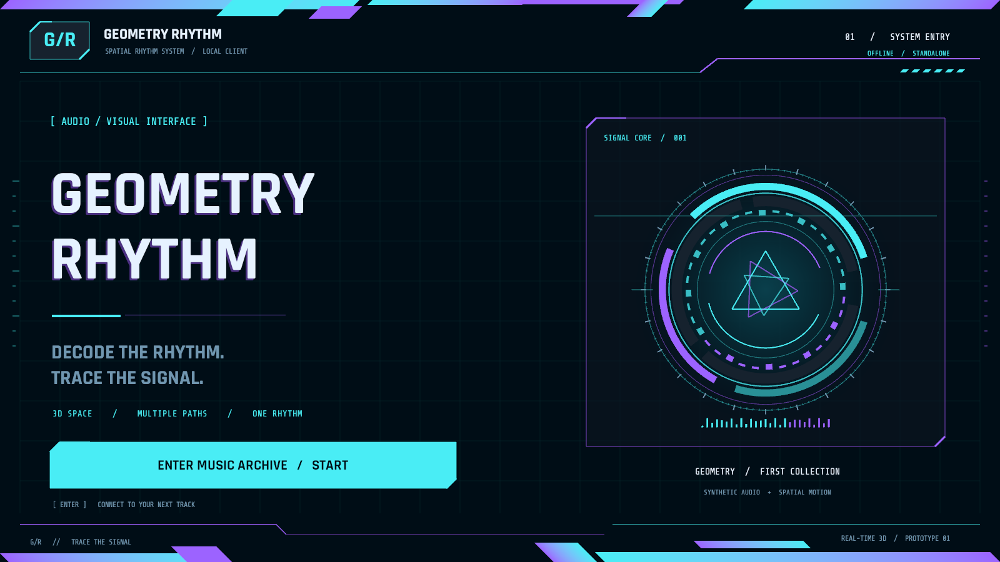


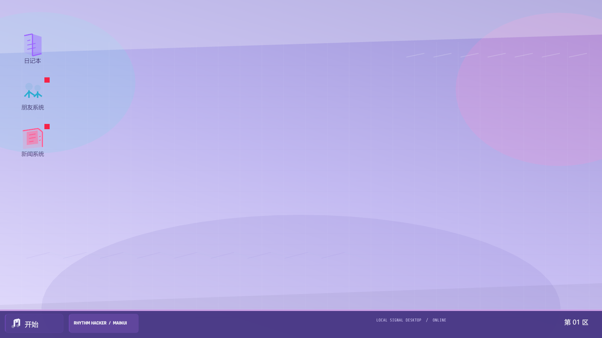

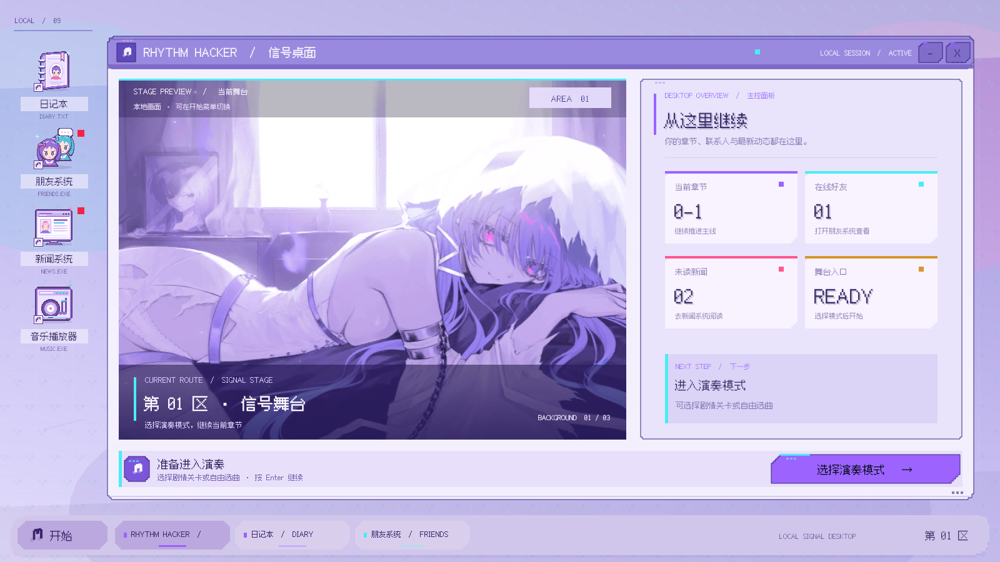

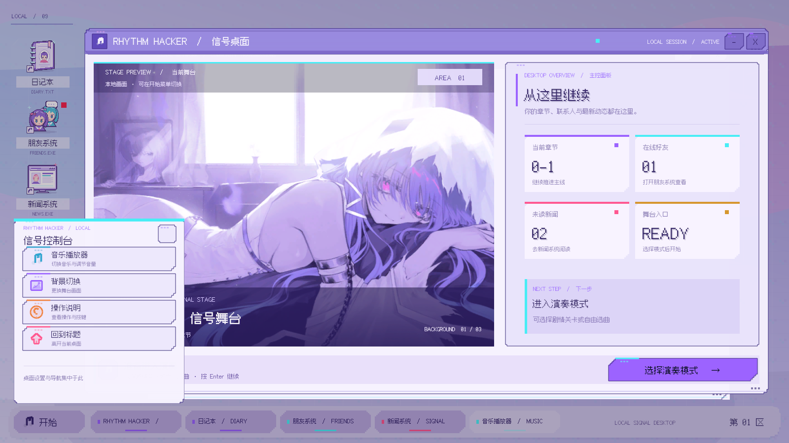

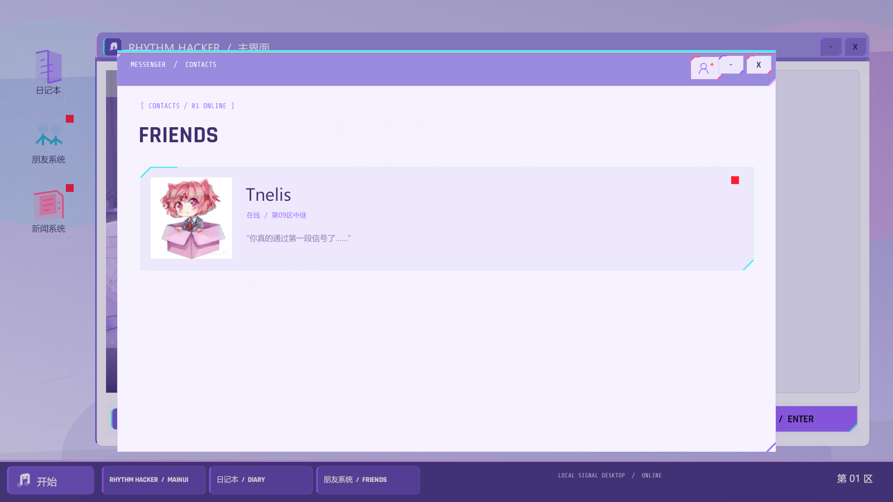

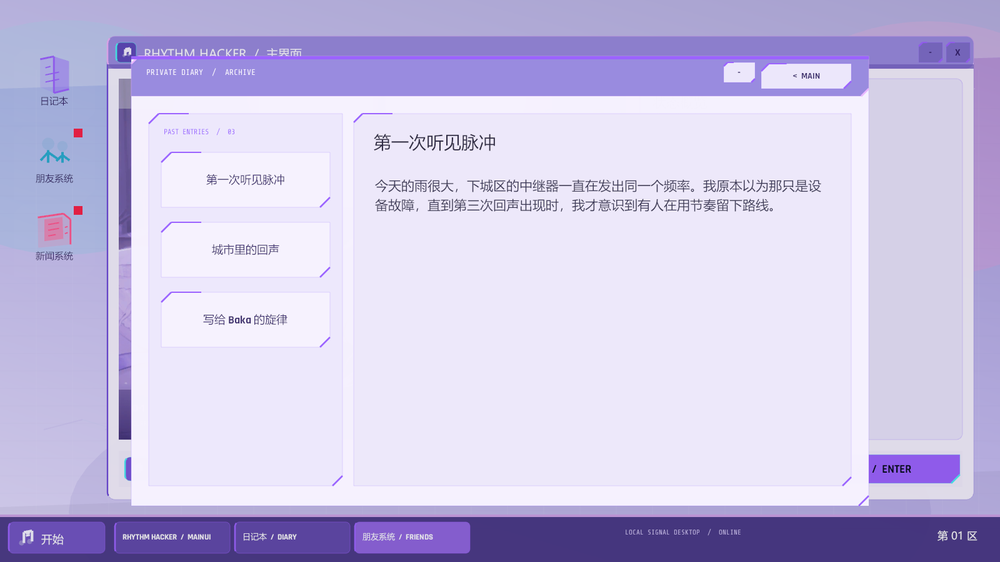

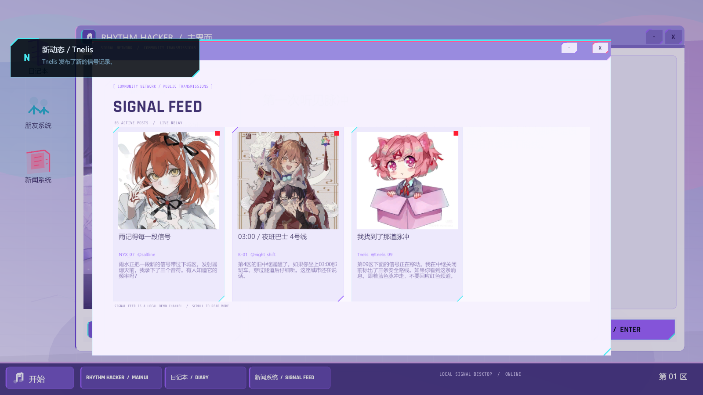

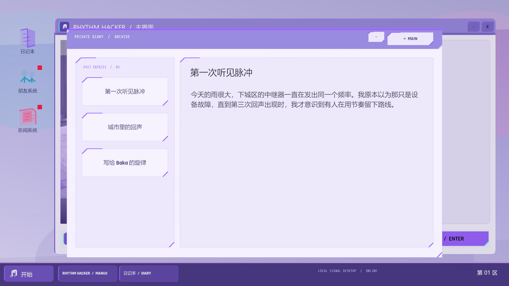

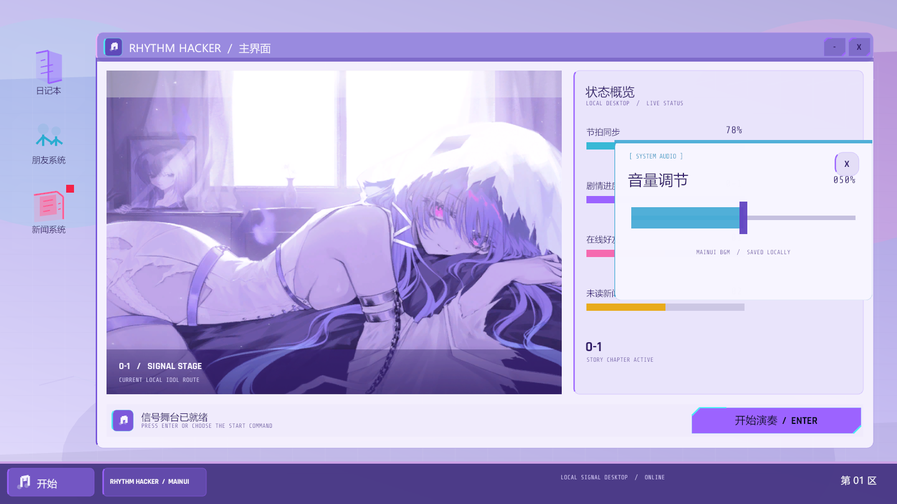

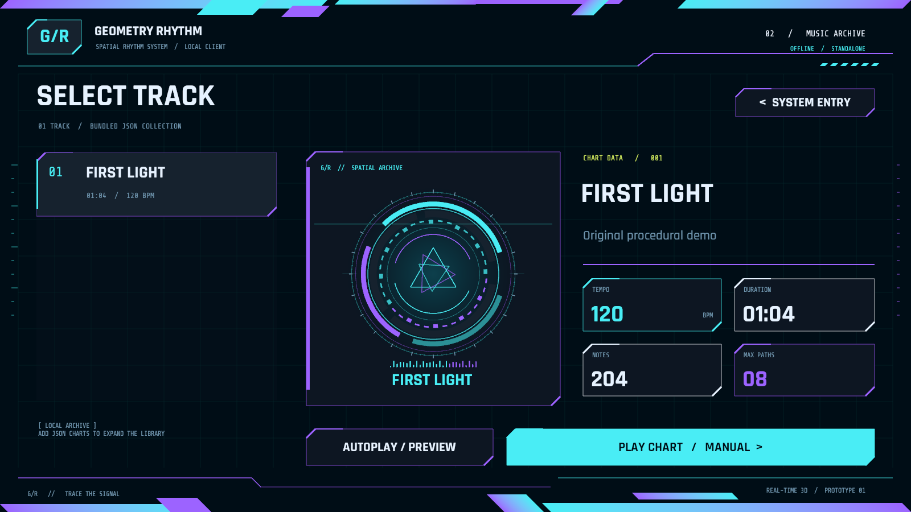

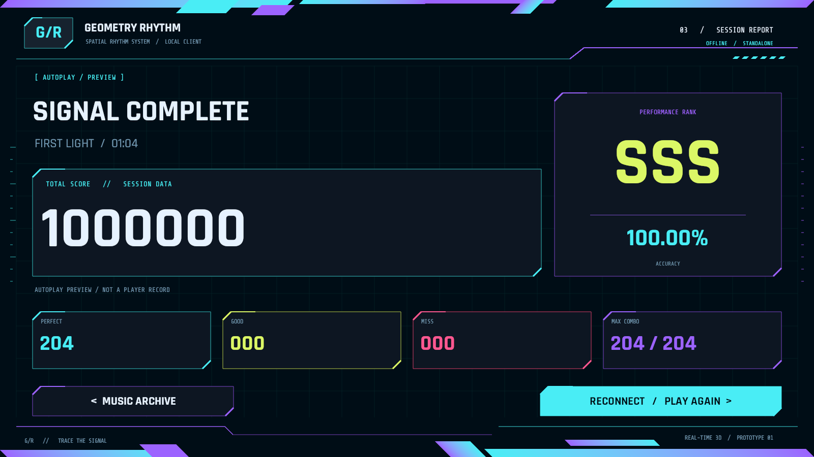

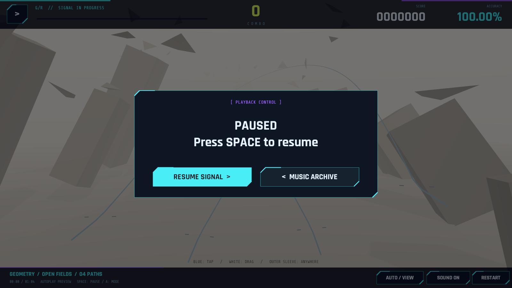

当前仍是可继续迭代的 Demo：没有联网、账号、存档、排行榜、难度分组、搜索、手柄焦点导航、移动端真机字体／安全区验收。

### 2026-10-02 — 模式卡片悬停动效

- 模式选择页整张剧情/自由模式卡片（插画、文案和按钮）响应鼠标悬停，沿用原点击路由。
- 剧情卡片中列车保持固定位置；城市远景、近景与桥墩分层向左循环，速度分别为 15.4 / 44 / 88 设计像素每秒。
- 自由模式卡片中唱片通过像素弧形反光和标签标记旋转（200 度/秒），唱针在悬停时落向唱片，移开时抬起，右下角带轻量节奏指示。
- 起动约 0.65 秒，减速约 0.85 秒，唱针过渡 0.45 秒。使用不受游戏时间缩放影响的时间；窗口失焦或路由过渡锁定时减速停止。
- 动效限制为 24 Hz 网格绘制，静止时不持续重建图形；其他页面的同类插画保持静态。
- 运行验证：`-frontendSmoke -musicScreensCapture <目录> -modeHoverCapture`，包含左右区域切换、文字区域命中、离开后完全停止与原模式路由检查。
- 验证结果：239 项构建检查通过；模式录制 548 帧全部通过，悬停预览 8.87 秒并通过完整解码；逐帧像素比较确认列车本体固定、城市/唱片变化以及离开后画面停止。Editor 45 次真实 UI 射线交互检查通过，0 错误。
- 预览：`Docs/Screenshots/mode-hover-preview.mp4`。

### 2026-10-02 — 透视唱片架 / 章节档案架

参考用户指定视频 https://www.bilibili.com/video/BV1XBaK6pECN/ 中实际可见的专辑盒陈列、抽出和详情切换，并核对作者项目说明 https://github.com/RonaldDeng/Rhine-Music-Demo 。采用原创 Unity UI 几何实现，没有导入参考项目的代码、封面或商标。

- 替换剧情章节页和自由选曲页；模式选择页的列车/唱片悬停仍保留。
- 进入后约 1.25 秒内，平面盒体排列逐渐变为有透视、厚度和地面纵深的陈列。粉紫色同步过渡为深蓝紫底色、冷青边光与淡紫主操作。
- 可点击盒体、滚轮、方向键、左右按钮或拖动浏览；右侧列表同步选择，独立确认进入。选中盒体抽出，其他盒体后退，详情局部更新，不重建页面或重播入场。
- 锁定章节允许查看档案，确认按钮禁用，Enter 同样不能进入。当前只有 0-1 可玩；自由模式按真实曲库显示，不添加虚假曲目。
- 3D 盒体和地面通过同一透视投影绘制到 UGUI；命中检测使用绘制后的四边形。只绘制当前项附近最多 9 个盒体，静止后停止网格重建。
- `PixelAlbumShelf.cs` 负责投影、盒体、相机展开、浏览和拾取；`RhythmFrontendAlbumSelection.cs` 负责共享页面、真实数据与入口路由。
- 最终验证：239 项构建检查通过；Player 614 帧录制检查通过，包含多曲目快速换选、拖动、空曲库与真实曲库恢复；Editor 48 次 UI 射线交互检查通过，0 错误，包含投影盒体拾取、章节锁定、手动/自动演奏、返回与重登录。
- Editor 验证中发现的 CanvasRenderer 依赖遗漏已通过显式 RequireComponent 修复，并重新完成全部交互检查。
- 预览：`Docs/Screenshots/album-selection-preview.mp4`（仅展示真实章节与真实曲库，不包含测试曲目）；截图 `ui-story-album-shelf.png`、`ui-free-album-shelf.png`。视频已完整解码验证。

### 2026-10-02 — 浅紫唱片架与无侧栏信息布局

按最新反馈恢复原浅粉紫色调，取消此前进场时转暗的配色动画，保留 2D 到 3D 透视展开。

- 整体唱片架横向展开，占据页面主体；补充底座、背板、侧挡板、支脚和分隔槽，选中盒体向前抽出。空槽保持可见，仅按真实曲库显示唱片，不用虚假唱片填满空间。
- 删除右侧大信息面板；条目列表移到架体下方，横向滚动，当前条目自动保持可见。
- 下方开放区域保留曲名、作者、BPM、时长、音符数和最大轨道数。剧情页保留章节编号、名称、介绍、开放/锁定状态及锁定说明。
- 主操作与自动预览放在信息区右端；保留滚轮、键盘、拖动、盒体点击、列表与前后切换，以及原有模式返回与章节锁定。
- 使用原 MainUI 的浅紫标题栏、紫色按钮、深紫文字和柔和像素底栏。
- 最终验证：239 项构建检查通过；614 帧 Player 检查通过；Editor 48 次交互通过，0 错误，附加确认旧侧栏已移除且曲目标题、音符数、最大轨道数仍显示。验证覆盖盒体拾取、锁定章节、手动演奏、自动预览及返回重登录。
- 最新视频：`Docs/Screenshots/pastel-rack-preview.mp4`，已完整解码；截图：`ui-free-pastel-rack.png`、`ui-story-pastel-rack.png`。

### 2026-10-02 — 参考视频的斜向专辑阵列

本轮以视频横屏实机演示的阵列构图为准，替换上一版实体槽架。保留浅粉紫配色、像素封面和原有游戏路由。

- 薄型宽 CD 盒、三列纵深阵列、斜向压缩视角；当前唱片升起并向镜头抽出，邻项保留队列位置，连续切换保留速度。
- 约 1.25 秒从平面陈列展开为透视阵列。静止时不持续重建网格。
- 移除实体底座和大块下方列表，使用右侧无边框排版与底部编号导航。标题、作者、BPM、时长、音符/轨道数、章节状态和进入/预览操作均保留。
- 背景为无封面、不可点击的空唱片套；可选盒体、计数和入口只来自真实章节/曲库，不把装饰当作歌曲。
- 保留投影盒体点击、滚轮、键盘、拖动、锁定章节、空库与长列表的处理。参考项目代码、美术及商标未导入。
- 最终验证：239 项构建检查通过；611 帧 Player 检查通过；48 次 Editor 射线交互通过，0 错误。覆盖新投影视角的盒体拾取、章节锁定、快速切换、拖动、多曲/空曲库、手动/自动演奏与返回。
- 预览：`Docs/Screenshots/diagonal-archive-preview.mp4`，9.40 秒、1600×900、30 fps，已完整解码验证；截图 `ui-story-diagonal-archive.png`、`ui-free-diagonal-archive.png`。

### 2026-10-02 — 唱片与阵列共用槽位 / 模式进入选曲过渡

- 修复真实唱片与空套采用不同位置、旋转和缩放的问题。真实唱片直接替换中央列槽位，与空套共用 360×280 尺寸、朝向、112 深度间距及相机；选中只抬升 24 单位并亮起青色边缘，不再额外放大或向镜头漂出。
- 实体与空套按同一视空间深度排序，点击判定遵循同样遮挡。侧列错开深度并裁掉过近装饰，避免空套压住主列封面。
- 点击剧情/自由模式后，选中的模式卡片在 0.46 秒内展开到选曲视口，其他内容淡出；再以 0.42 秒交叠淡化衔接阵列展开，信息分段显现。整个过程约 1.7 秒，不新增加载停顿。
- 新过渡仅用于模式选择入口，保留游戏返回选曲的原路由；过渡中统一锁住点击和键盘切页，结束后清理遮罩并恢复输入。
- Player/Editor 检查增加了过渡出现、结束和输入锁释放的验证，保留实际盒体拾取、章节锁定、手动/自动演奏及返回检查。
- 最终验证：239 项构建检查、647 帧 Player 录制检查、48 次 Editor 交互检查通过，Editor 0 错误。补充更新旧截图冒烟脚本，使其等待新入口动画结束再检查选曲页。
- 新预览：`Docs/Screenshots/integrated-shelf-entry-preview.mp4`（10.80 秒、1600×900、30 fps，完整解码通过）。新截图：`ui-story-integrated-shelf.png`、`ui-free-integrated-shelf.png`。

### 2026-10-02 — Gymnopedie 默认曲目与连续 2D→3D 入场

- 原样导入用户提供的 `Erik Satie,Mark Allaway - Gymnopedie No.1.mp3` 到 `Resources/Music/player-gymnopedie-no1.mp3`，源/目标 SHA-256 一致；完整解码通过。播放器显示曲名、作者及 02:53 时长，五行曲目重新排布，音量条不被遮挡。
- 新安装默认选中索引 4；既有存档通过 `RhythmHacker.GymnopedieDefault.v1` 一次性迁移到此曲，之后继续记住玩家自行选择的音乐。保留原音量设置和其他场景音乐。
- 模式卡片中的插画交叠变为平面 CD 封面，同一个 PixelAlbumShelf 实例跨页面复用，不在中途换成另一张图。相机从正面逐渐转为俯视斜向透视，盒体显出厚度，周围唱片套随深度展开。约 2.06 秒结束，保持唱片与阵列共用槽位。
- 原创 `album-unfold`（2.04 秒）与 `album-settle`（0.62 秒）两枚 48 kHz 立体声音效，采用低强度玻璃泛音与平滑带限扫音。入口不再叠加普通 open 音，展开、完成各触发一次；使用重要音效声道，避免普通点击截断。
- 可复现音效生成脚本：`Tools/Audio/design_album_transition.py`。原音效资产保持不变。
- 验证：239 项构建检查通过；748 帧 Player 检查通过，包含默认歌曲实际播放、旧/新歌曲切换、两种模式入口和音效触发计数；48 次 Editor 射线交互通过，0 错误。AudioListener 实际录音峰值 0.3215，无削波；未以静态合成样本替代 Unity 播放证据。
- 带实际录音预览：`Docs/Screenshots/album-2d-3d-with-sound.mp4`，12.91 秒、1600×900、30 fps、48 kHz 双声道，完整解码通过。默认播放器截图：`ui-gymnopedie-default.png`。

### 2026-10-02 — 两次点击取出唱片后显示详情

- 删除浏览状态右侧固定信息区，阵列扩展到完整 1600 宽视口，仅保留编号、前后导航和操作提示。
- 第一次点击唱片只选中（包括初始默认高亮的唱片）；再次点击同一张唱片才取出。没有双击时间限制，拖动/滚轮不会触发取出。编号和方向键可选中，Enter 可取出。
- 取出过程约 0.65 秒：唱片从真实槽位向前移出、转为正面并放大，背景阵列降低视觉强度；完成后才显示下方的标题、说明、BPM/时长、音符/轨道信息，以及进入章节、开始演奏、自动预览按钮。
- 锁定章节可以取出查看，入口保持禁用；空曲库无法取出。放回按钮和 Escape 将唱片原路放回，第二次 Escape 返回模式页。
- 取出或放回期间禁用浏览和重复取出，确认进入必须处于已取出状态。覆盖同一帧打开后立即取消的输入恢复。
- 修复隐藏信息区过早启动动画造成 CanvasGroup 透明的问题，信息只在实际展示后做淡入；Editor 检查验证祖先组透明度。
- 最终验证：239 项构建检查、880 帧 Player 录制检查、52 次 Editor 射线交互通过，Editor 运行错误为 0；剧情进入、自动预览、手动演奏与返回流程保持正常。实际截图确认剧情和自由模式取出后文字、指标及按钮可见。
- 新预览：`Docs/Screenshots/album-take-out-preview.mp4`，15.94 秒、1600×900、30 fps，包含 Unity 实际 48 kHz 立体声录音，完整解码通过。截图：`ui-album-story-select.png`、`ui-album-story-taken.png`、`ui-album-free-taken.png`。
